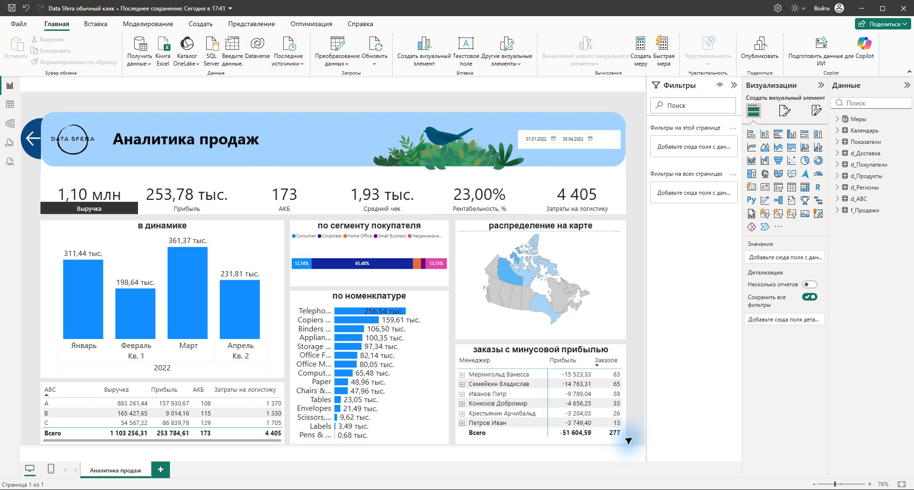
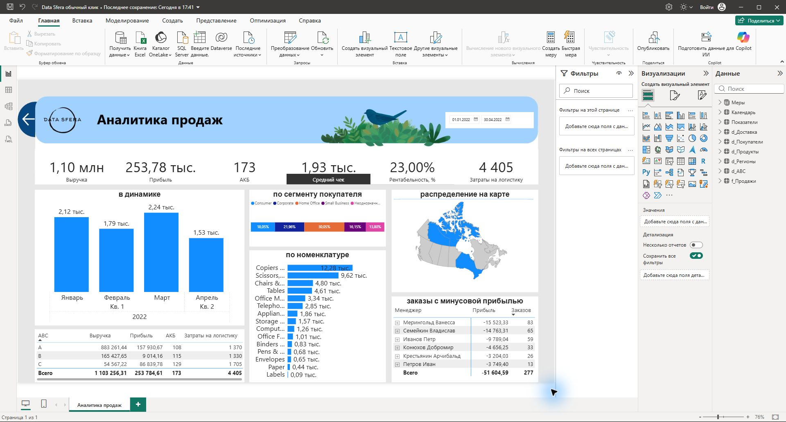
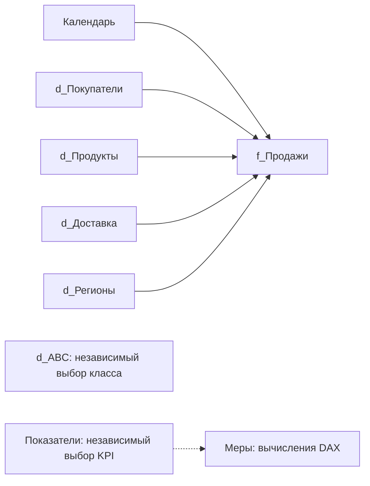

# Data Sfera — аналитика продаж в Power BI

Тестовое задание по подготовке данных, построению модели и разработке интерактивного отчёта о продажах. Отчёт помогает оценить выручку, прибыль, рентабельность, активную клиентскую базу, средний чек и расходы на доставку, сравнить товары и сегменты покупателей и найти убыточные заказы.

**Автор портфолио:** [EIenaAbramova](https://github.com/EIenaAbramova).

## Результат

Одна страница в стиле предоставленного образца: шесть KPI, динамика по месяцам, сравнение сегментов покупателей и номенклатуры, карта Канады, ABC-таблица и матрица убыточных заказов по менеджерам.

- [Готовый файл Power BI](DataSfera.pbix).
- [Редактируемый проект PBIP](DataSfera-PBIP.zip).
- [Меры DAX с объяснениями](MEASURES.md) и [полная выгрузка всех выражений](measures.dax).
- [Подробный конспект выполнения](Конспект%20выполнения%20Data%20Sfera.docx).
- [Исходная база](База%20данных_основная.xlsx).

GitHub не показывает интерактивное содержимое PBIX в браузере. Для исследования отчёта скачайте файл и откройте его в Power BI Desktop. Данные включены в файл; вход в Microsoft Fabric для локального просмотра не требуется.

## Как пользоваться

1. Открыть `DataSfera.pbix` в Power BI Desktop. Редактируемый проект находится в `DataSfera-PBIP.zip`: распаковать архив и открыть `Data Sfera обычный клик.pbip`.
2. Выбрать период в правом верхнем углу.
3. **Обычным одиночным кликом** нажать в области числа или подписи любой из шести карточек: выручка, прибыль, АКБ, средний чек, рентабельность, логистика. Дополнительные клавиши не нужны, в том числе в редакторе Power BI Desktop.
4. Чёрная полоса показывает активный показатель. Вместе с ней переключаются динамика, сегментный график, номенклатура и карта.
5. Для детализации номенклатуры использовать команды перехода по иерархии; для детализации убыточных заказов раскрыть менеджера в матрице.
6. Выделение столбца месяца фильтрует остальные блоки. Повторный выбор снимает выделение.

Переключение KPI реализовано нативным кнопочным срезом с единственным выбором. Прозрачные ячейки среза покрывают всю площадь шести карточек и выбирают строку независимой таблицы `Показатели`. Меры `SELECTEDVALUE` / `SWITCH` меняют содержимое графиков и условные цвета подписей. Поэтому полоса следует за обычным кликом по карточке, а выбранные даты сохраняются. ABC и убыточные заказы сохраняют своё назначение при выборе любого KPI.




## Задача и состав данных

Источник — Excel с продажами и справочниками дат заказов, покупателей, продуктов, менеджеров и стоимости доставки. Анализируемый период: январь–апрель 2022 года. Фактические продажи заканчиваются 29 апреля; календарь и срез включают 30 апреля.

Единица наблюдения — строка продажи товара внутри заказа. В очищенной базе 730 строк, 571 уникальный заказ, 173 покупателя и 445 товаров.

| Файл | Содержание |
| --- | --- |
| `DataSfera.pbix` | Готовый отчёт с загруженными данными и обычным кликом по KPI |
| `DataSfera-PBIP.zip` | Редактируемый проект: PBIR, модель и ресурсы оформления |
| `MEASURES.md`, `measures.dax` | Объяснения и полный текст 32 мер, включая динамические форматы |
| `Конспект выполнения Data Sfera.docx`, `.md` | Подробная подготовка данных и расчётов; актуальное переключение описано здесь |
| `База данных_основная.xlsx` | Исходная книга задания |
| `analyze.py`, `requirements.txt` | Независимый расчёт и проверка данных |
| `validation.json` | Результаты проверки обычных кликов и повторного открытия |
| `preview-*.png` | Реальные снимки сохранённого PBIX после повторного открытия |

## Подготовка данных

1. Исключены пустые строки, оставшиеся в форматированной области листа Excel.
2. Выручка и прибыль приведены к числовому типу, даты — к типу даты, идентификаторы и ключи согласованы со справочниками.
3. Проверено существование ключей заказа, продукта, покупателя, региона и доставки в соответствующих справочниках.
4. Наименования продуктов приведены к тексту, включая числовые значения в исходнике.
5. Полная копия исходной книги не добавлялась в факт повторно.
6. У 18 покупателей найдено несколько противоречивых сегментов. Их продажи сохранены в отдельной группе «Неоднозначный сегмент», без дублирования факта и произвольного выбора сегмента.
7. Необычные значения прибыли сохранены: без подтверждения источника отрицательные строки и прибыль выше выручки не исправлялись вручную.

В переносимом PBIX и PBIP используется встроенный типизированный снимок таблиц Power Query. Он не требует абсолютного пути к Excel на другом компьютере. Команда «Обновить» перечитывает снимок; для получения новых продаж требуется заменить источник запросов либо заново подготовить модель. Это ограничение текущей поставки, а не подключение к обновляемому интернет-источнику.

## Модель

Модель организована по принципу звезды: `f_Продажи` — факт, справочники фильтруют его связями «один ко многим». Двунаправленные связи для этой задачи не требуются.



`d_ABC` не соединяется физической связью с фактом: состав классов зависит от фильтров и вычисляется мерами. Независимая таблица «Показатели» содержит шесть строк и не связана с фактом. Таблица «Меры» содержит 32 меры: 17 бизнес-мер, 2 меры переключения, 12 мер условного цвета и одну SVG-меру карты.

## Основные показатели

| Показатель | Правило расчёта | Полный период |
| --- | --- | ---: |
| Выручка | Сумма Revenue | 1 103 256,31 |
| Прибыль | Сумма Profit | 253 784,61 |
| Рентабельность | Прибыль / Выручка | 23,00% |
| АКБ | Уникальные Buyer | 173 |
| Заказы | Уникальные Order_ID | 571 |
| Средний чек | Выручка / Заказы | 1 932,15 |
| Логистика | Сумма тарифа доставки по строкам | 4 405 |
| Убыточные заказы | Заказы с суммой Profit < 0 | 277 |

Валюта исходником не задана. АКБ и число заказов неаддитивны: один покупатель или заказ может встречаться в нескольких группах.

Основные формулы:

```dax
Выручка = SUM('f_Продажи'[Revenue])
Прибыль = SUM('f_Продажи'[Profit])
Рентабельность = DIVIDE([Прибыль], [Выручка])
АКБ = DISTINCTCOUNT('f_Продажи'[Buyer])
Заказы = DISTINCTCOUNT('f_Продажи'[Order_ID])
Средний чек = DIVIDE([Выручка], [Заказы])
Затраты на логистику = SUMX('f_Продажи', RELATED('d_Доставка'[Стоимость]))
```

Остальные формулы — убыточные заказы, прибыль убыточных заказов, ранг, доля, накопленная доля, класс ABC и четыре итога ABC — приведены целиком в [MEASURES.md](MEASURES.md).

## ABC-анализ

Товары сортируются по убыванию выручки в текущем выборе. Класс A охватывает первые 80% выручки, B — следующие 15%, C — остаток. Для однозначного распределения пересекающий порог товар включён в предыдущую группу: класс определяется накопленной долей до текущего товара. При равной выручке используется название товара.

| Класс | Товаров | Выручка | Прибыль | АКБ | Логистика |
| --- | ---: | ---: | ---: | ---: | ---: |
| A | 114 | 883 261,44 | 157 930,67 | 108 | 1 370 |
| B | 123 | 165 427,65 | 9 014,16 | 115 | 1 330 |
| C | 208 | 54 567,22 | 86 839,78 | 129 | 1 705 |

Итог АКБ вычисляется заново, а не суммирует значения A, B и C. Для передачи списка товаров выбранного класса в факт используется `TREATAS`, для сохранения текущих ограничений — `KEEPFILTERS`, для выбранного пользователем множества — `ALLSELECTED`.

## Логистика и убыточные заказы

Стоимость доставки по приложенному чек-листу начисляется на строку продажи: 151 строка Express Air × 10 и 579 строк Regular Air × 5 дают 4 405. У 28 заказов несколько способов доставки; начисление одного тарифа на заказ потребовало бы дополнительного бизнес-правила.

Убыточный заказ определяется после суммирования его строк в текущем контексте. Сумма количеств по менеджерам равна 279, общий итог — 277: четыре заказа встречаются в нескольких регионах, и контекст менеджера влияет на состав и прибыль заказа. Поэтому итог матрицы не обязан равняться сумме строк менеджеров.

## Карта и сегменты

Карта — SVG с границами провинций из [Natural Earth](https://www.naturalearthdata.com/downloads/10m-cultural-vectors/10m-admin-1-states-provinces/), встроенный в нативную таблицу Power BI. Она пересчитывается по фильтрам и выбранному KPI. С настройками безопасности внешних карт ничего делать не требуется. Однозначно сопоставлены Ontario, Nunavut и Northwest Territories. Агрегированные West, Atlantic и Prarie не распределялись по провинциям без подтверждённого правила; остальные территории серые. Клик по SVG не является выбором региона, поскольку это изображение внутри таблицы.

Сегментная диаграмма нормирована до 100% для соответствия образцу. Ширина сегмента показывает долю его значения в сумме показанных значений; исходное значение доступно в подсказке. Для рентабельности и среднего чека это сравнение нормированных показателей, а не доля общей выручки. При анализе отрицательной прибыли необходимо учитывать отрицательные значения сегментов.

## Проверки и отличия от образца

Итоги сверены независимо на Python и запросами DAX в локальной модели Power BI. Проверяются суммы, уникальные ключи, ABC и поведение кнопок. Готовый PBIX сохраняется самим Power BI Desktop и повторно открывается с данными.

Числа в исходной базе не полностью совпадают с изображением задания. Например, выручка базы 1 103 256,31 выше показанной на образце на 6 168,39. Рентабельность и средний чек поэтому отличаются; значения не подгонялись под картинку. Оформление повторяет образец по расположению и шапке, с небольшими отличиями шрифтов и отображения карты.

Исходные изображения используются как оформление предоставленного задания; числовые блоки отчёта являются живыми визуализациями, а не изображением результата.

## Независимая проверка на Python

Требуется Python и `openpyxl`:

```bash
python -m pip install -r requirements.txt
python analyze.py
```

Скрипт читает книгу из своей папки, проверяет соответствие справочникам и сохраняет очищенные данные и контрольные расчёты в `validation/python/`. Он не редактирует PBIX: визуальный отчёт редактируется в Power BI Desktop.

## Технологии

Power BI Desktop, Power Query M, DAX, PBIP/PBIR, Python, openpyxl, SVG, Natural Earth.
